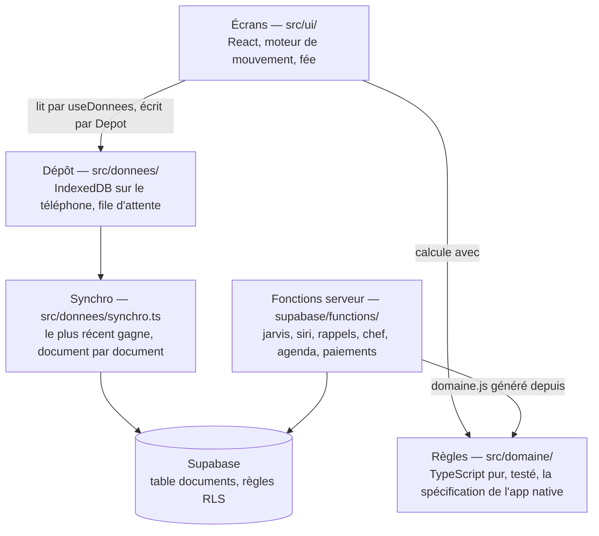

# Architecture de Kora

Kora tient en quatre couches qui ne se parlent que dans un sens : l'écran lit et écrit par le
dépôt, le dépôt range sur le téléphone et partage par le serveur, et toutes les règles vivent dans
une couche pure que les fonctions serveur reprennent telle quelle.

## Les couches

| Couche | Dossier | Règle d'or |
| --- | --- | --- |
| Règles | `src/domaine/` | Aucun import de React, du DOM ou du stockage. L'heure et les identifiants passent par `Contexte`. Chaque fichier a ses tests à côté. |
| Dépôt | `src/donnees/` | Le seul accès aux données (`Depot`). Les écrans n'ouvrent jamais IndexedDB eux-mêmes. |
| Écrans | `src/ui/` | Lisent par `useDonnees`, écrivent par le `Depot`. Les réglages propres au téléphone passent par `stockageLocal.ts`. |
| Styles | `src/styles/` | Couleurs, tailles de texte et mouvements en jetons (`base.css`). Un fichier par écran, `surcharges.css` en dernier. |
| Serveur | `supabase/` | `schema.sql` complet, plus une migration datée par changement. Les fonctions reprennent les règles par `npm run fonction`. |

## Les collections

Tout ce que le foyer partage est rangé en collections de documents JSON, déclarées une seule fois
dans `src/domaine/collections.ts`. Chaque collection est à la fois un magasin IndexedDB sur le
téléphone et une valeur de la colonne `collection` de la table `documents` du serveur. Un test
vérifie que le registre et le serveur acceptent exactement les mêmes.

Quand un document change, le dépôt prévient ses abonnés avec la liste des collections touchées ;
`useDonnees` ne relit que celles-là, et les autres gardent le même tableau.

## Le partage

Chaque téléphone garde toutes les données et marche hors ligne. Une modification devient un
« changement » daté, mis en attente, puis envoyé ; à l'arrivée, le plus récent gagne, document par
document (`src/domaine/synchro.ts`). Ce qui est effacé passe 30 jours dans la corbeille partagée.

## Les vérifications

| Quand | Quoi |
| --- | --- |
| À chaque PR (`verifier`) | Types, correcteur (oxlint), tests (Vitest), build |
| À chaque PR (`essai`) | Chaque écran dans un iPhone simulé, sombre, clair et grands caractères, avec axe ; captures gardées 14 jours |
| À chaque fusion dans `main` | Les mêmes vérifications, puis publication sur GitHub Pages |
| Deux nuits par semaine | La veille : serveur, sécurité, dépendances, données du foyer (`/mnt/project-files/veille/PROCEDURE.md`) |
